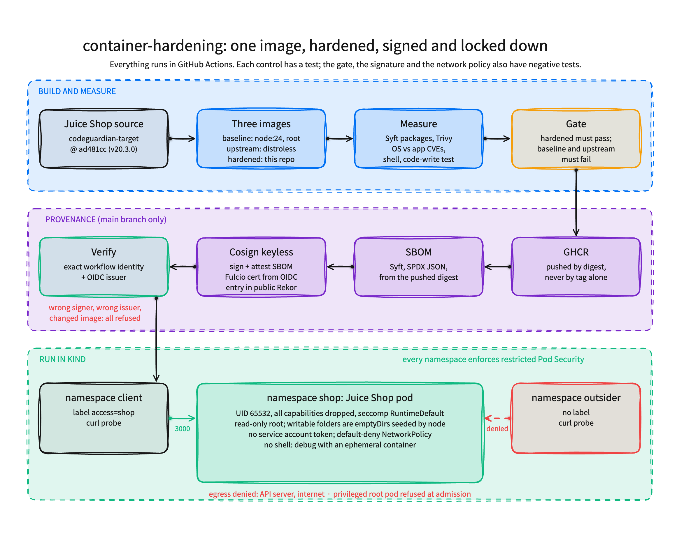

# container-hardening

Takes one container image, OWASP Juice Shop v20.3.0, and shrinks what an attacker can do
with it. The image is hardened, scanned, given an SBOM, signed, and run in a Kubernetes
cluster that refuses anything weaker. Every control is shown working, and the main ones
are also shown failing when they are removed.



## What it does

All of it runs in GitHub Actions (`.github/workflows/build.yml`).

1. **Builds three images from the same source** (`codeguardian-target` at `ad481cc`):
   - `baseline`: one stage on `node:24`, run as root. The way many images are first written.
   - `upstream`: Juice Shop's own Dockerfile, already distroless and non-root.
   - `hardened`: `docker/hardened.Dockerfile`.
2. **Measures each one** (`scripts/measure.sh`): size, packages (Syft), CVEs split into the
   OS layer and the application layer (Trivy), whether a shell exists, and whether the
   user the image runs as can change the application's code. Each check prints a yes or
   a no; a check that cannot run stops the job instead of passing.
3. **Gates the hardened image** (`scripts/gate.sh`). It must run as non-root, have no
   shell, keep its code read-only to the app user, and have no critical or high OS CVE
   that has a fix. The same gate must refuse the other two images.
4. **Signs it** (main branch only). The image is pushed to GHCR by digest. Syft makes an
   SPDX SBOM from the pushed digest. Cosign signs the digest and attests the SBOM with a
   short-lived certificate tied to this workflow's GitHub identity (keyless signing), and
   records both in the public Rekor log. `scripts/verify-signature.sh` checks the exact
   signer and issuer, then proves that a wrong signer, a wrong issuer and a changed image
   are all refused.
5. **Runs it in kind** (`make cluster test-cluster`). Every namespace enforces the
   `restricted` Pod Security Standard, and the shop namespace denies all traffic except
   TCP 3000 from one labelled namespace. Juice Shop runs with a read-only root filesystem;
   the seven folders it writes are `emptyDir` volumes that an init container fills first.
   `scripts/cluster-test.sh` checks each control.

## Results

Measured in CI run [43821705627](https://github.com/Keniolax/container-hardening/actions/runs/43821705627)
(Syft 1.55.0, Trivy 0.76.1, database of 2026-11-16):

| | baseline | upstream | hardened |
|---|---|---|---|
| Size (MB) | 1,761 | 331 | 330 |
| Runs as | root | 65532 | 65532 |
| Shell in image | yes | no | no |
| App user can change the app code | yes | **yes** | no |
| Debian packages | 413 | 14 | 14 |
| npm packages | 1,373 | 725 | 728 |
| OS CVEs (critical + high) | 4,378 (704) | 57 (0) | 57 (0) |
| OS CVEs, critical + high with a fix | 188 | 0 | 0 |
| App CVEs (critical + high) | 94 (44) | 70 (36) | 70 (36) |

The gate passed `hardened` and refused the other two. Upstream fails on one check: its app
user owns every file, so code execution in the app can rewrite `build/app.js`.

The app CVEs are left as shipped. Juice Shop is vulnerable on purpose, and its challenges
depend on those packages. Only the OS layer, which this repo chooses, is gated.

Signed image: `ghcr.io/keniolax/container-hardening/juice-shop@sha256:8ba647f47b5a3f0050f297c158f862975b1ec2ac6c760d58af7e78615fd89922`,
signer `https://github.com/Keniolax/container-hardening/.github/workflows/build.yml@refs/heads/main`.
The SBOM attestation lists 744 packages. Verification refused another repo's workflow,
another OIDC issuer, and the same image with one label changed (`no signatures found`).

In kind (Kubernetes 1.37, restricted Pod Security on every namespace):

- a privileged pod running as root is refused when it is created;
- the `client` namespace reaches Juice Shop (HTTP 200); the `outsider` namespace gets no
  connection; the Juice Shop pod cannot reach the API server or the internet;
- with the network policies removed, `outsider` gets HTTP 200 and the pod reaches the API
  server, so the policies are what block them; re-applied, the block returns;
- in the running pod, `sh` does not exist, writing `build/app.js` fails with `EACCES`, no
  service account token is mounted, and the app runs as UID 65532;
- an ephemeral debug container (`kubectl debug --profile=restricted`) is admitted, sees the
  Juice Shop process as PID 1, and lists its files through `/proc/1/root`.

## Run it

The workflow does everything. To repeat the cluster part on a Linux amd64 machine with
Docker:

```sh
scripts/install-tools.sh          # pinned syft, cosign, trivy, kind, kubectl, sha256-checked
make verify  IMAGE_REF=ghcr.io/keniolax/container-hardening/juice-shop@sha256:<digest>
make cluster IMAGE_REF=ghcr.io/keniolax/container-hardening/juice-shop@sha256:<digest>
make test-cluster
make snapshot > snapshot.json     # pods, services, service accounts, network policies
make down
```

`IMAGE_REF` must name a digest. A tag can be moved to other bytes; a digest cannot.

## What I learned

- Distroless removed the most: 399 of 413 Debian packages, every shell and all 188 fixable
  critical and high OS CVEs. It does not remove the runtime. `node -e` still runs code, and
  this repo uses it to seed volumes and test the pod.
- Non-root is not enough. Upstream runs as UID 65532 but gives that user its own code. Ask
  what the running user can write, not only who it is.
- A read-only root filesystem finds every path an app writes. Juice Shop crashed at startup
  with `EROFS` on `.well-known/csaf/provider-metadata.json`, a path its own Dockerfile does
  not list as writable.
- A check that cannot run must fail. Two checks here first passed without checking: a probe
  that could not find `node` in a distroless image, and a CI step whose `make | tee` hid a
  failed rollout (GitHub's default shell has no `pipefail`). The gate's negative test caught
  the first; reading the job log caught the second.
- Check what a tool's output means. `cosign verify` in Cosign 3 lists the SBOM attestation as
  a verified bundle next to the signature, so the script now requires the signature type
  (`https://sigstore.dev/cosign/sign/v1`) and not just any verified bundle.
- Verify a signature against an exact identity and issuer. Anyone can get a Sigstore
  certificate; only this workflow on `main` can get this one.
- A NetworkPolicy does nothing unless the network plugin enforces it. Remove the policy and
  watch the blocked connection succeed: that proves the policy, not something else, was
  blocking it.
